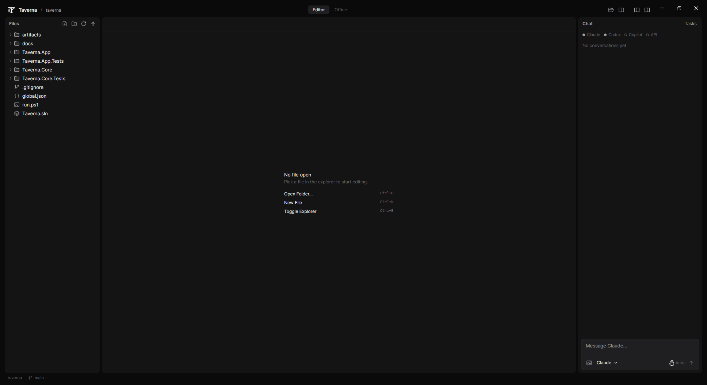
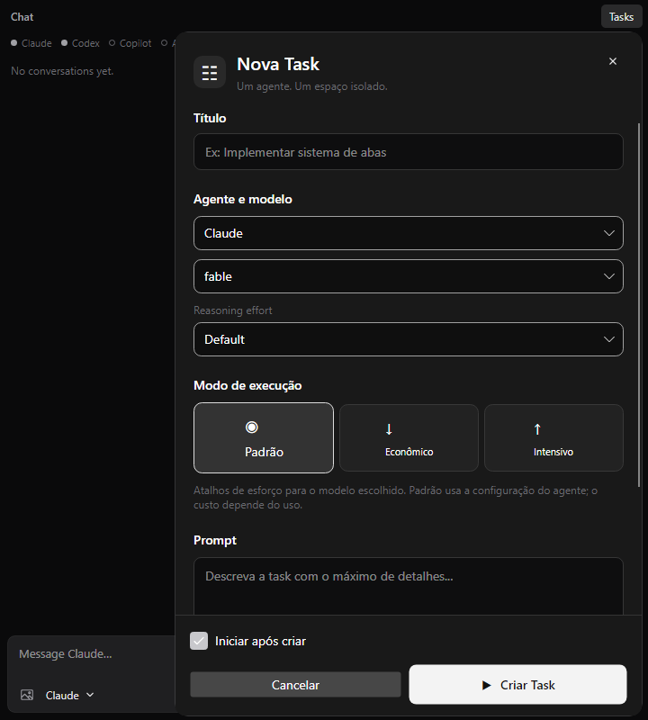
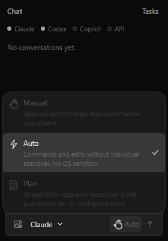

<div align="center">


# Taverna

**Uma mesa para todos os seus agentes de código.**

Claude, Codex e Copilot trabalhando juntos no mesmo projeto, cada um no seu canto,<br/>
com você no balcão decidindo o que entra e o que fica de fora.


</div>

<br/>

<p align="center">
  
</p>

---

## 🍺 O que é

Hoje cada agente de IA vive no próprio terminal, com a própria janela e o próprio histórico.
Você copia contexto de um lado para o outro, perde a conta de quem mexeu em quê, e torce
para dois agentes não editarem o mesmo arquivo ao mesmo tempo.

O **Taverna** junta tudo isso num lugar só. Abra a pasta do projeto e você tem, lado a lado,
os arquivos, o editor e uma conversa em que vários agentes participam. Quando o trabalho
for maior, mande cada agente para a própria mesa: ele trabalha isolado e você só traz para
o projeto o que aprovar.

## ✨ O que dá pra fazer

<table>
<tr>
<td width="50%" valign="top">

### 💬 Uma conversa, vários agentes
Converse com o Claude, peça uma segunda opinião ao Codex e chame o Copilot, tudo na mesma
conversa. Cada agente enxerga o que os outros já disseram, então ninguém começa do zero.

</td>
<td width="50%" valign="top">

### 🧵 Tarefas em paralelo
Crie várias tarefas e deixe agentes diferentes trabalharem ao mesmo tempo. Cada um ganha uma
cópia isolada do projeto, e um não atropela o outro.

</td>
</tr>
<tr>
<td width="50%" valign="top">

### ✅ Você decide o que entra
Terminou uma tarefa? Veja o resultado e escolha: **juntar** ao projeto ou **descartar**.
Se houver conflito, o Taverna ajuda a resolver sem perder nada.

</td>
<td width="50%" valign="top">

### 🖼️ Mostre, não só descreva
Anexe prints e imagens na conversa. Um bug visual ou um rascunho de tela explicam mais
do que três parágrafos.

</td>
</tr>
<tr>
<td width="50%" valign="top">

### 📝 Editor de verdade
Explorador de arquivos, abas e tela dividida para ler e ajustar o código sem sair do app.

</td>
<td width="50%" valign="top">

### 🔐 Permissões claras
Para cada agente você vê o que ele pode fazer, sem letras miúdas. O que não é seguro de
oferecer simplesmente não aparece como opção.

</td>
</tr>
</table>

## 🪑 Por dentro

<table>
<tr>
<td width="62%" valign="top">

</td>
<td width="38%" valign="top">

### Nova tarefa

*Um agente. Um espaço isolado.*

Dê um título, escolha o agente e o modelo, diga quanto esforço ele deve gastar e descreva
o que precisa ser feito. Pronto: a tarefa começa a rodar em segundo plano enquanto você
continua trabalhando.

<br/>

### Modos de permissão



</td>
</tr>
</table>

## 🧭 Como funciona, em quatro passos

| | |
|:-:|---|
| **1** | **Abra o projeto** — qualquer pasta com git vira uma taverna. |
| **2** | **Converse** — tire dúvidas, peça ideias, compare respostas de agentes diferentes. |
| **3** | **Delegue** — transforme o que precisa ser feito em tarefas e solte os agentes. |
| **4** | **Revise e junte** — traga para o projeto só o trabalho que ficou bom. |

## 🚪 Entrando

O Taverna usa os agentes que você já tem instalados e autenticados na máquina:
[Claude Code](https://claude.com/claude-code), [Codex CLI](https://github.com/openai/codex)
e [GitHub Copilot CLI](https://docs.github.com/copilot). Com pelo menos um deles pronto:

```powershell
git clone https://github.com/CaduhRoman/taverna-harness.git
cd taverna-harness
dotnet run --project Taverna.App
```

> Quer os detalhes técnicos? Veja [docs/cli-notes.md](docs/cli-notes.md) e
> [docs/chat-permissions.md](docs/chat-permissions.md).

<br/>

<div align="center">
<sub>Feito com ☕ e alguns agentes à mesa.</sub>
</div>
